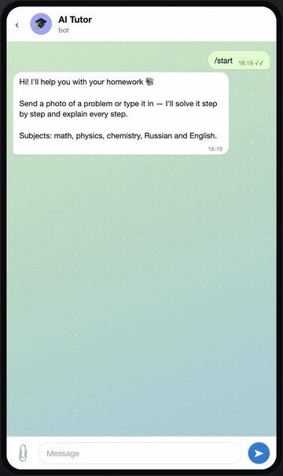
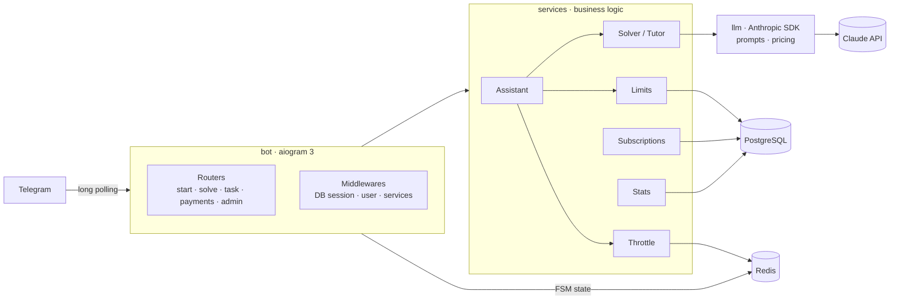

# AI Tutor Bot

[](https://github.com/DimaPlaz/ai-tutor/actions/workflows/ci.yml)

A Telegram bot that solves school problems from a photo or text and explains every step in plain language. Students get a free monthly allowance; after that they can subscribe with Telegram Stars.

<p align="center">
  
  <br><sub>Demo recording of the chat flow (simulated chat)</sub>
</p>

## Features

- **Photo or text → step-by-step solution.** Math, physics, chemistry, Russian and English. Formulas are rendered as Unicode text, so they are readable right in Telegram.
- **Tutoring dialog for each problem.** Students can tap *Explain simpler*, *Check my answer* or ask a follow-up question in the context of the same problem (up to 5 follow-ups per problem). If a follow-up is actually a new problem, the bot solves it as a new task.
- **Russian and English.** The language is detected from Telegram and can be switched with `/lang`.
- **Free plan with a hard cost cap.** There are 15 free solutions per calendar month (UTC), plus a hidden monthly budget in dollars, so one heavy user cannot burn through the LLM bill.
- **Subscription with Telegram Stars.** It costs 250 ⭐ for 30 days and renews automatically. Users can turn renewal off or on in `/subscription`.
- **Admin commands in Telegram.** `/stats` shows users, solutions, revenue, LLM costs and cost per solution. `/grant <user_id> <days>` gives a subscription manually, and `/refund <charge_id>` returns Stars.
- **Test mode.** With `LLM_FAKE=true` the bot runs end to end without an Anthropic API key, using canned answers with realistic token usage.

## Architecture



The aiogram handlers are thin: they parse the input and send the reply. Everything else lives in `services/` and is tested without Telegram.

**Design decisions**

- **LLM cost control.** Every Claude call is stored in `llm_calls` with its token counts (input, output, cache read and cache write) and its cost in USD. The cost is computed per attempt, so a server-side fallback to a backup model is priced correctly. Calls that fail after tokens were already billed are counted against the budget too. A user is limited by the number of solutions *and* by a monthly dollar budget: one for the free plan and a higher one for subscribers.
- **Reliable answers.** The bot uses structured JSON output with a schema. It checks `stop_reason` (`refusal`, `max_tokens`) before reading the response and validates the payload with Pydantic. A failed or refused call never uses up a free solution, and the student gets a clear message instead.
- **Idempotent payments.** A subscription is credited only on `successful_payment`. The `INSERT … ON CONFLICT DO NOTHING` uses a unique index on `telegram_payment_charge_id`, and recording the payment and extending the subscription happen in one transaction, so a duplicate update never extends a subscription twice. `pre_checkout_query` checks the currency, the amount and that the payer is the user the invoice was issued to.
- **Anti-spam.** Redis holds a per-user lock, so a user can have only one LLM request in flight at a time, plus a per-minute rate limit.
- **Long messages.** Solutions are split on Telegram's 4096-character limit without breaking HTML tags.
- **Observability.** Logs are JSON. Tokens, keys and full payment events are never logged; only a short prefix of the charge ID is.

## Tech stack

Python 3.14 · aiogram 3 · PostgreSQL + SQLAlchemy 2 (async) + Alembic · Redis · Anthropic SDK · pydantic-settings · pytest · ruff · pyright · Docker Compose · GitHub Actions

```
src/tutor_bot/
  main.py        entry point: bot, routers, polling
  config.py      settings from .env
  bot/           routers, keyboards, middlewares, RU/EN texts, message formatting
  services/      solver, tutor, limits, throttle, subscriptions, stats
  llm/           Anthropic client, prompts, pricing, fake client for test mode
  db/            models, repositories, session
migrations/      Alembic
tests/           pytest (real Postgres/Redis, mocked Telegram and LLM)
```

## Quick start

You need Docker and a bot token from [@BotFather](https://t.me/BotFather).

```bash
cp .env.example .env    # set TG_BOT_TOKEN and SUPPORT_CONTACT; LLM_FAKE=true runs without an API key
docker compose up -d --build
docker compose logs -f bot
```

The bot applies migrations on start. To use real Claude, set `ANTHROPIC_API_KEY` and `LLM_FAKE=false`.

### Local development

```bash
python3.14 -m venv venv && source venv/bin/activate
pip install -e ".[dev]"
docker compose up -d db redis     # ports are exposed to localhost by docker-compose.override.yml
alembic upgrade head
python -m tutor_bot.main

pytest
ruff check . && ruff format . && pyright
```

In test mode (`LLM_FAKE=true`) you can include trigger words in a message to simulate failures: `fake:unreadable`, `fake:not_a_problem`, `fake:refusal`, `fake:max_tokens`, `fake:error`, `fake:long`.

## Configuration

All settings come from `.env`. See [`.env.example`](.env.example) for the full list.

| Variable | Default | Description |
|---|---|---|
| `TG_BOT_TOKEN` | — | Bot token from @BotFather |
| `TG_TEST_ENV`, `TG_TEST_BOT_TOKEN` | `false` | Use the Telegram test environment (for payment testing) |
| `ANTHROPIC_API_KEY` | — | Claude API key (not needed when `LLM_FAKE=true`) |
| `LLM_MODEL` | `claude-opus-5-5` | Claude model |
| `LLM_EFFORT` | `medium` | Reasoning effort: `low` … `max` |
| `LLM_FAKE` | `false` | Canned answers, no API calls |
| `FREE_SOLUTIONS_PER_MONTH` | `15` | Free solutions per calendar month (UTC) |
| `FREE_BUDGET_USD` / `PAID_BUDGET_USD` | `0.90` / `2` | Monthly LLM spend cap per user, free / subscribed |
| `SUBSCRIPTION_PRICE_STARS` | `250` | Subscription price for 30 days |
| `SUPPORT_CONTACT` | — | Contact shown in `/paysupport` |
| `RATE_LIMIT_PER_MINUTE` | `6` | LLM requests per user per minute |
| `ADMIN_IDS` | — | Comma-separated Telegram IDs allowed to use admin commands |
| `POSTGRES_PASSWORD` | `tutor` | Postgres password used by Docker Compose |

## Deployment (VPS)

Any small VPS works: 1 vCPU and 1–2 GB of RAM are enough. The bot uses long polling, so no ports need to be open.

```bash
# on the server (Ubuntu)
apt-get update && apt-get install -y docker.io docker-compose-v2
git clone git@github.com:DimaPlaz/ai-tutor.git /opt/ai-tutor && cd /opt/ai-tutor   # private repo: add a read-only deploy key
cp .env.example .env && chmod 600 .env
# in .env: tokens, ADMIN_IDS, POSTGRES_PASSWORD=$(openssl rand -hex 24), and
# COMPOSE_FILE=docker-compose.yml:docker-compose.prod.yml   (production files, log rotation)
docker compose up -d --build
```

Update: `git pull && docker compose up -d --build`.

Backups: `scripts/backup.sh` dumps Postgres to `backups/` and keeps the last 7 dumps. Run it daily with cron:

```
0 3 * * * /opt/ai-tutor/scripts/backup.sh >> /var/log/ai-tutor-backup.log 2>&1
```

Restore: `gunzip -c backups/<file>.sql.gz | docker compose exec -T db psql -U tutor -d tutor`.
